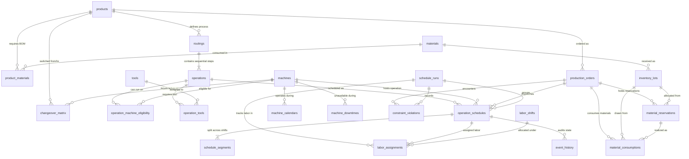
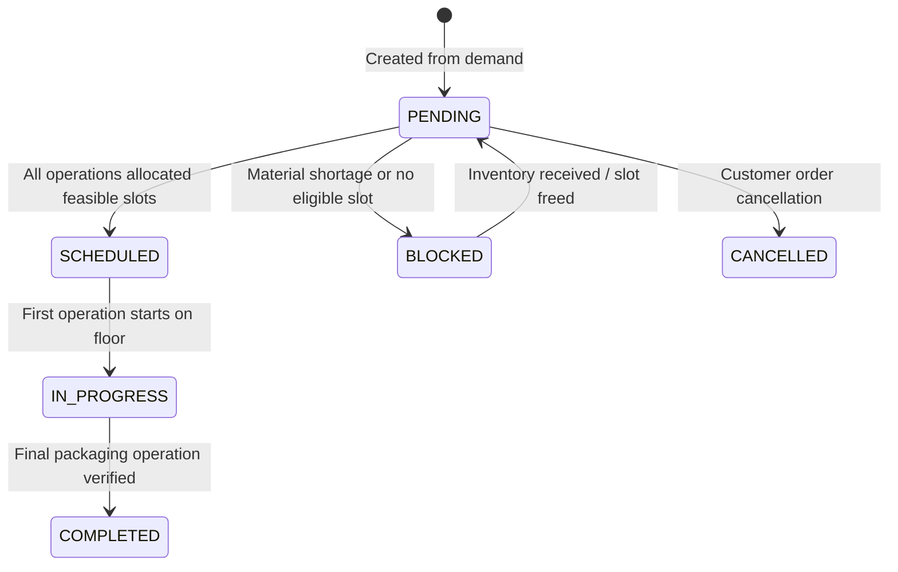
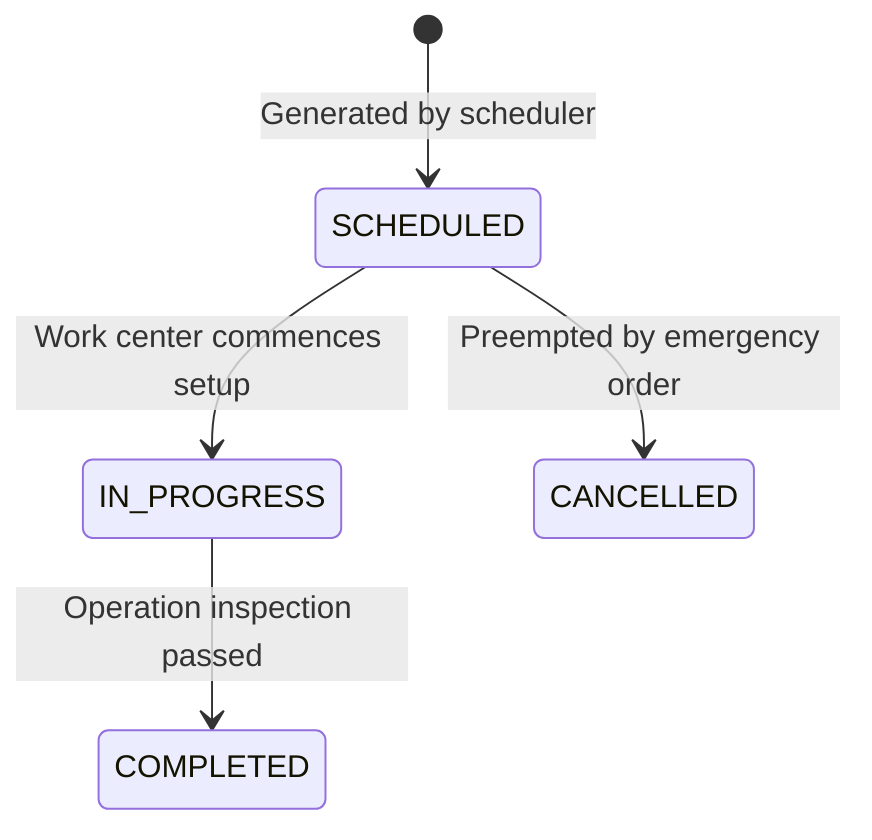
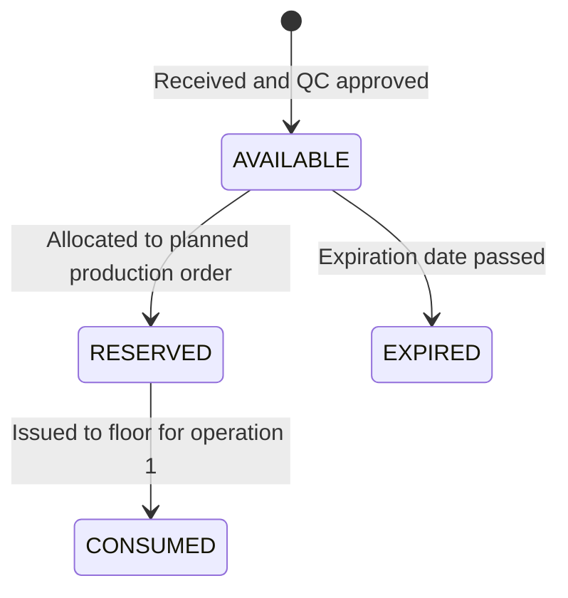

# YottaFlex Manufacturing - Database Architecture & Schema Documentation

This document describes the relational database schema, entity-relationship cardinality, foreign key constraints, bridge tables, and lifecycle states for the YottaFlex Manufacturing Planning and Scheduling System.

---

## 1. Entity-Relationship Architecture (Mermaid)

---

## 2. Entity Cardinality and Relationship Matrix

| Parent Entity | Child Entity | Cardinality | Relationship Type | Foreign Key | Cascade / Integrity |
|---|---|:---:|---|---|---|
| `products` | `routings` | 1 : 1 (or 1 : N) | Master-Detail | `routings.product_id` | Enforced FK |
| `routings` | `operations` | 1 : N | Master-Detail | `operations.routing_id` | Enforced FK |
| `products` | `materials` | N : M | Bridge (`product_materials`) | `product_id`, `material_id` | Unique pair constraint |
| `materials` | `inventory_lots`| 1 : N | Parent-Child | `inventory_lots.material_id` | Enforced FK |
| `operations`| `machines` | N : M | Bridge (`operation_machine_eligibility`) | `operation_id`, `machine_id` | Unique pair constraint |
| `operations`| `tools` | N : M | Bridge (`operation_tools`) | `operation_id`, `tool_id` | Unique pair constraint |
| `machines` | `machine_calendars`| 1 : N | Recurring Shift Schedule | `machine_calendars.machine_id` | Enforced FK |
| `machines` | `machine_downtimes`| 1 : N | Maintenance Window | `machine_downtimes.machine_id` | Enforced FK |
| `machines` | `changeover_matrix`| 1 : N | Transition Rules | `changeover_matrix.machine_id` | Unique (m, from, to) |
| `production_orders`| `operation_schedules`| 1 : N | Job Assignments | `operation_schedules.production_order_id` | Enforced FK |
| `schedule_runs`| `operation_schedules`| 1 : N | Run Batching | `operation_schedules.schedule_run_id` | Enforced FK |
| `operation_schedules`| `schedule_segments`| 1 : N | Shift-Broken Intervals | `schedule_segments.operation_schedule_id`| Unique (sched_id, seg_no) |
| `operation_schedules`| `labor_assignments` | 1 : N | Workforce Shift Allocations | `labor_assignments.operation_schedule_id` | Enforced FK |
| `labor_shifts` | `labor_assignments` | 1 : N | Labor Capacity Management | `labor_assignments.labor_shift_id` | Enforced FK |
| `production_orders`| `material_reservations`| 1 : N | Pre-Production Stock Allocations | `material_reservations.production_order_id` | Enforced FK |
| `material_reservations`| `material_consumptions`| 1 : 1 / 1 : N | Physical Drawdowns | `material_consumptions.reservation_id` | Enforced FK |
| `schedule_runs`| `constraint_violations`| 1 : N | Exception Logging | `constraint_violations.schedule_run_id` | Enforced FK |

---

## 3. Bridge Tables for Many-to-Many Relationships

1. **`product_materials`**:
   - Resolves N:M cardinality between finished products and raw materials.
   - Enforces unique `(product_id, material_id)` pair constraint.
   - Holds quantity multiplier per single unit of output.

2. **`operation_machine_eligibility`**:
   - Resolves N:M cardinality between operations and compatible workstations.
   - Enforces unique `(operation_id, machine_id)` constraint.
   - Allows activating/deactivating individual eligibility links.

3. **`operation_tools`**:
   - Resolves N:M cardinality between operations and shared tooling fixtures.
   - Enforces unique `(operation_id, tool_id)` constraint.
   - Tracks required concurrent tool units.

---

## 4. Lifecycle States & State Transitions

### A. Production Order Lifecycle

### B. Operation Schedule Lifecycle

### C. Inventory Lot Lifecycle

---

## 5. Audit Logging (`event_history`)
All state-altering actions persist immutable records to `event_history`:
- `entity_type`: String designation (e.g. `OperationSchedule`, `ProductionOrder`)
- `entity_id`: Primary key of modified entity
- `event_type`: Categorical event (`SCHEDULE_CREATED`, `STATUS_CHANGED`, `ORDER_CANCELLED`)
- `old_values`: JSON payload snapshot prior to change
- `new_values`: JSON payload snapshot post change
- `actor`: Initiator ID (`SYSTEM`, `PLANNER`, `OPERATOR`)
- `occurred_at`: Strict UTC/Local server execution timestamp
